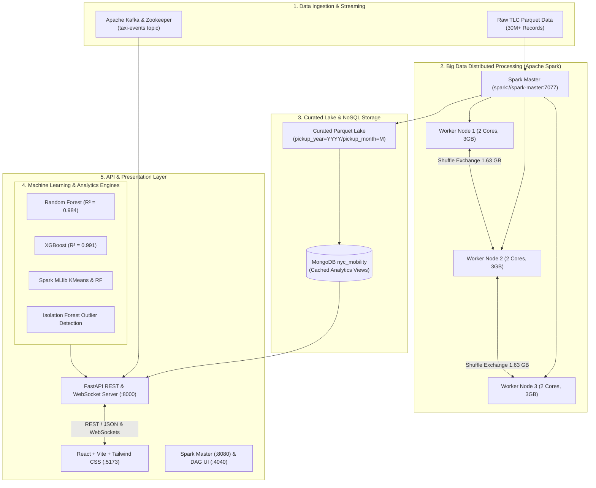

# 🚕 NYC Mobility Intelligence Platform

[]()
[]()
[]()
[]()
[]()
[]()
[]()
[]()
[]()
[]()

> **An enterprise-grade, end-to-end Big Data Analytics and Machine Learning platform analyzing 30+ million New York City Taxi & Limousine Commission (TLC) trip records.**
> 
> Features distributed data harmonization, machine learning demand forecasting, explainable fare estimation, real-time Kafka event streaming, and a full Docker-based 4-node Apache Spark cluster (1 Master + 3 Workers) with live DAG visualization and network shuffle metrics.

---

## 📑 Table of Contents
- [Project Overview](#-project-overview)
- [System Architecture](#-system-architecture)
- [Key Features](#-key-features)
- [Tech Stack](#-tech-stack)
- [Repository Structure](#-repository-structure)
- [Quick Start Guide](#-quick-start-guide)
  - [Prerequisites](#prerequisites)
  - [1. Clone & Python Environment](#1-clone--python-environment)
  - [2. Launch the Web Platform](#2-launch-the-web-platform-frontend--backend)
  - [3. Run the Distributed Spark Cluster](#3-run-the-distributed-spark-cluster-1-master--3-workers)
  - [4. Real-Time Kafka Streaming](#4-real-time-kafka-streaming-optional)
- [Distributed Spark Cluster Architecture](#-distributed-spark-cluster-architecture)
- [Machine Learning Benchmark](#-machine-learning-benchmark)
- [Port Reference](#-port-reference)
- [Troubleshooting & FAQ](#-troubleshooting--faq)
- [License](#-license)

---

## 🌟 Project Overview

Urban mobility in New York City is one of the most complex transportation ecosystems globally. This platform ingests historical and streaming TLC trip records to solve core transportation challenges:

* **Massive Distributed Computation**: Cleans and aggregates tens of millions of records partitioned by year, month, and vehicle class using Apache Spark.
* **Predictive Demand Intelligence**: Deploys Random Forest, XGBoost, and ARIMA-mimic models to forecast trip demand up to 90 days out with real-time weather surge adaptation.
* **Explainable Fare Economics**: Implements spatial Haversine road detour matrices (1.32x road curvature factor) alongside official TLC regulatory rules (e.g., Rule 58 $70 flat airport fares).
* **Live Telemetry Streaming**: Ingests high-throughput taxi pickup/dropoff events over Apache Kafka and streams them to the browser via WebSockets.
* **Cluster Visualization**: Features a dedicated 4-node Apache Spark standalone cluster (1 Master + 3 Workers) to showcase partition distribution, task parallelism across 6 CPU cores, and inter-node network data shuffles (>1.6 GB exchanged).

---

## 🏗️ System Architecture



---

## 🚀 Key Features

### 1. 📊 Interactive Executive Dashboard (`/overview`)
* High-level mobility KPIs (Total trips, gross revenue, top active zones, average trip distance).
* Multi-year historical volume trajectory and borough market share breakdown.

### 2. 🔍 NYC Taxi Zone Data Explorer (`/explorer`)
* In-depth analytics for all **263 official NYC taxi zones**.
* Real-time search, borough filter dropdown (Manhattan, Brooklyn, Queens, Bronx, Staten Island, EWR), and instant CSV data export.

### 3. 📈 Machine Learning Demand Forecaster (`/forecast`)
* Select any borough or zone with dynamic forecast horizons (12 Hours, 24 Hours, 7 Days, 30 Days, 90 Days).
* Compare algorithms: **XGBoost ($R^2 = 0.991$)**, **Random Forest ($R^2 = 0.984$)**, and **ARIMA-Mimic**.
* **Weather Simulation**: Model weights automatically adjust for severe weather conditions (e.g., Heavy Rain increases taxi demand by ~35%, Snowstorm reduces volume by ~40%).

### 4. 🚖 Intelligent Fare Predictor (`/fare`)
* Real-world GPS coordinates for 26 prominent NYC landmarks and airports across all 5 boroughs.
* **Haversine Distance with 1.32x Urban Road Detour Factor**: Auto-calculates realistic street driving distances.
* Enforces NYC TLC regulations:
  * Base fare (\$3.00) + \$3.50/mile + \$0.70/min traffic-weighted duration.
  * Peak hour (\$2.50) and overnight (\$1.00) surcharges.
  * **TLC Rule 58**: Mandatory \$70.00 JFK $\leftrightarrow$ Manhattan flat fare.
  * **Official Interstate Surcharge**: \$20.00 surcharge for Newark Airport (EWR).

### 5. ⚠️ Explainable AI Anomaly Detection (`/anomalies`)
* Employs **Isolation Forests** and **Z-Score Thresholding** to detect:
  * Zero-distance high-fare anomalies (potential driver meter tampering).
  * Extreme trip duration outliers (GPS disconnection).
  * Negative / invalid fare records (refunds and processing glitches).
  * Speed limit violations (>100 mph impossible intra-city trips).
* Provides transparent root cause explanation and automated operational recommendations.

### 6. 🌐 Mobility Origin-Destination Network (`/network`)
* Visualizes inter-borough mobility graphs and hub centralities.
* Analyzes top traffic corridors (e.g., JFK Airport $\rightarrow$ Midtown, LaGuardia $\rightarrow$ Upper East Side) with passenger flow volume.

### 7. ⚡ Real-Time Simulation & Telemetry (`/simulation`)
* Ingests continuous taxi trips streamed through **Apache Kafka** (`taxi-events` topic).
* Dual-mode failover: seamlessly falls back to a high-frequency realistic city-wide simulation stream via WebSockets if Kafka is offline.
* Live event feed displaying pickup/dropoff corridors, trip distance, fare, and timestamp.

### 8. 🖥️ Distributed Apache Spark Cluster (1 Master + 3 Workers)
* **Master Node** (`spark://spark-master:7077`) + **3 Worker Nodes** running in isolated Docker containers.
* Distributes 30+ million records across **52 partitions** and executes wide transformations in parallel across 6 worker cores.
* Demonstrates **1.63 GB of inter-node network data shuffle** and live DAG execution on port `4040`.

---

## 💻 Tech Stack

| Layer | Technologies |
| :--- | :--- |
| **Distributed Big Data** | Apache Spark 4.2.0 / 3.5, PySpark, Spark SQL, Spark MLlib |
| **Real-Time Streaming** | Apache Kafka 7.4, Apache Zookeeper, kafka-python |
| **Database & Cache** | MongoDB (NoSQL), Curated Apache Parquet Data Lake |
| **Machine Learning** | Scikit-Learn, XGBoost, Statsmodels (ARIMA), Joblib, NumPy, Pandas |
| **Backend API** | FastAPI, Uvicorn, Motor (Async MongoDB), WebSockets, Pydantic |
| **Frontend UI** | React 18, TypeScript, Vite, Tailwind CSS, Lucide React, Recharts |
| **DevOps & Containers** | Docker, Docker Compose, Windows PowerShell / Linux Bash |

---

## 📁 Repository Structure

```text
BDA-Project/
├── backend/
│   ├── main.py                     # FastAPI server (REST endpoints, WebSocket stream, ML inference)
├── data/
│   ├── curated/trips/              # Partitioned Parquet data lake (pickup_year=YYYY/...)
│   ├── raw/                        # Raw TLC trip parquet downloads
│   ├── models/                     # Spark MLlib saved models (RandomForest, KMeans)
│   ├── zones_fallback.json         # 263 NYC Taxi Zones offline fallback cache
│   ├── network_fallback.json       # Mobility graph nodes and links fallback
│   └── anomalies_fallback.json     # Curated explainable anomaly detection records
├── frontend/
│   ├── src/
│   │   ├── pages/                  # React views (Home, Explorer, Forecast, Fare, Network, RealTime)
│   │   ├── components/             # Reusable UI components (Layout, TaxiLightButton, etc.)
│   │   ├── services/api.ts         # API client & WebSocket connections
│   │   └── App.tsx                 # Route declarations & navigation
│   ├── package.json
│   ├── vite.config.ts
│   └── tailwind.config.js
├── models/                         # Serialized Scikit-Learn / XGBoost models (.pkl)
│   ├── rf_demand_model.pkl
│   ├── rf_demand.pkl
│   ├── xgb_demand.pkl
│   └── arima_demand.pkl
├── scripts/
│   ├── run_spark_cluster_demo.bat  # 1-Click launcher for Windows Spark cluster job
│   ├── run_spark_cluster_demo.ps1  # PowerShell launcher for Spark cluster job
│   ├── spark_cluster_demo.py       # Distributed PySpark script (Map-Reduce, Shuffle, MLlib)
│   ├── data_collection/            # TLC scrapers and parquet integrity checkers
│   └── ml/                         # Offline model training & evaluation scripts
├── spark_jobs/
│   ├── 01_schema_inspection.py     # Schema inspection across Yellow/Green/FHV
│   ├── 02_harmonize_and_clean.py   # Distributed PySpark cleaning & Parquet curation
│   ├── 03_historical_analytics.py  # Historical aggregation jobs
│   ├── 04_machine_learning.py      # Distributed MLlib training pipelines
│   ├── 05_export_to_mongo.py       # Pipeline exporting aggregated views to MongoDB
│   ├── 06_streaming_producer.py    # Kafka trip event publisher
│   └── 07_structured_streaming.py  # Spark Structured Streaming consumer
├── docker-compose.yml              # Kafka & Zookeeper container stack
├── docker-compose.spark.yml        # Standalone Spark Cluster (1 Master + 3 Workers)
├── requirements.txt                # Python dependencies
└── result_report.md                # Comprehensive ML benchmark report with plots
```

---

## ⚡ Quick Start Guide

### Prerequisites
* **Python**: `3.10` or higher ([python.org](https://www.python.org/))
* **Node.js**: `18.x` or higher & `npm` ([nodejs.org](https://nodejs.org/))
* **Docker Desktop**: Recommended for the Spark cluster and Kafka ([docker.com](https://www.docker.com/))
* *(Optional)* **MongoDB**: Running on port `27017` (The backend contains automated offline fallback datasets, so MongoDB is not strictly required to run the UI).

---

### 1. Clone & Python Environment

```bash
# Clone the repository
git clone https://github.com/your-username/nyc-mobility-intelligence.git
cd nyc-mobility-intelligence

# Create and activate Python virtual environment
python -m venv venv

# Windows PowerShell:
.\venv\Scripts\Activate.ps1
# Linux/macOS:
source venv/bin/activate

# Install dependencies
pip install -r requirements.txt
```

---

### 2. Launch the Web Platform (Frontend + Backend)

#### Terminal 1: Start the FastAPI Backend
```bash
uvicorn backend.main:app --reload --host 0.0.0.0 --port 8000
```
*API is now live at: [http://localhost:8000](http://localhost:8000)*  
*Swagger Documentation: [http://localhost:8000/docs](http://localhost:8000/docs)*

#### Terminal 2: Start the React Frontend
```bash
cd frontend
npm install
npm run dev
```
*Dashboard is now live at: [http://localhost:5173](http://localhost:5173)*

> **Note:** The backend has built-in zero-friction fallbacks. If MongoDB is not running, the dashboard automatically loads curated offline data caches for all 263 zones, ML models, and network graphs without throwing errors.

---

### 3. Run the Distributed Spark Cluster (1 Master + 3 Workers)

To demonstrate distributed Big Data processing across multiple nodes:

#### Step 3.1: Spin up the 4 Spark Containers
```bash
docker compose -f docker-compose.spark.yml up -d
```
This launches:
- `spark-master` (Web UI: [http://localhost:8080](http://localhost:8080))
- `spark-worker-1` (Web UI: [http://localhost:8081](http://localhost:8081))
- `spark-worker-2` (Web UI: [http://localhost:8082](http://localhost:8082))
- `spark-worker-3` (Web UI: [http://localhost:8083](http://localhost:8083))

#### Step 3.2: Execute the Distributed Cluster Job
Run the one-click script:
```powershell
.\scripts\run_spark_cluster_demo.bat
```
*(Or on Linux/macOS or inside PowerShell)*:
```bash
docker exec -it -e PYTHONPATH=/opt/spark/python:/opt/spark/python/lib/py4j-0.10.9.9-src.zip spark-master python3 /opt/spark/scripts/spark_cluster_demo.py spark://spark-master:7077 /opt/spark/data/curated/trips
```

#### Step 3.3: Inspect the Live Spark Cluster UIs
While the script is running (or paused in presentation mode):
1. **Cluster Overview ([http://localhost:8080](http://localhost:8080))**: Shows 3 alive workers, 6 total cores, and 9 GB memory.
2. **Application & DAG UI ([http://localhost:4040](http://localhost:4040))**:
   - **`Executors` Tab**: Shows all 3 worker containers actively executing tasks in parallel, with CPU cores, memory, and shuffle network bytes transferred.
   - **`Stages` Tab $\rightarrow$ `DAG Visualization`**: Click on Stage 1 or Stage 3 to view the Directed Acyclic Graph showing the `Exchange` (Network Shuffle) step where 1.63 GB of data is exchanged between workers.
3. When finished presenting, press **`Enter`** in the terminal to cleanly terminate the session.

---

### 4. Real-Time Kafka Streaming (Optional)

To stream real-time taxi events through Apache Kafka:

```bash
# 1. Start Zookeeper & Kafka broker
docker compose -f docker-compose.yml up -d

# 2. Run the streaming producer (publishes trips from historical Parquet into Kafka)
python spark_jobs/06_streaming_producer.py
```
Open the **Real-Time Simulation** page in the frontend ([http://localhost:5173/realtime](http://localhost:5173/realtime)) to see live events streamed from Kafka directly into the UI!

---

## 🔬 Distributed Spark Cluster Architecture

During cluster execution of the Parquet dataset (`29,668,354 records`):

```text
+-----------------------------------------------------------------------------------------+
|                                    SPARK DRIVER                                         |
|                 (Job Scheduling, Logical Plan, Catalyst Optimization)                   |
+-----------------------------------------------------------------------------------------+
                                        |
               +------------------------+------------------------+
               |                        |                        |
               v                        v                        v
+-----------------------------+ +-----------------------------+ +-----------------------------+
|      SPARK WORKER 1         | |      SPARK WORKER 2         | |      SPARK WORKER 3         |
|  (172.18.0.3 - 2 Cores/3GB) | |  (172.18.0.4 - 2 Cores/3GB) | |  (172.18.0.5 - 2 Cores/3GB) |
|                             | |                             | |                             |
|  * Stage 1: Map Partitions  | |  * Stage 1: Map Partitions  | |  * Stage 1: Map Partitions  |
|  * Partial Hash Aggregation | |  * Partial Hash Aggregation | |  * Partial Hash Aggregation |
|  * Shuffle Write: 206.8 MiB | |  * Shuffle Write: 180.9 MiB | |  * Shuffle Write: 227.7 MiB |
+-----------------------------+ +-----------------------------+ +-----------------------------+
               \                        |                        /
                \                       |                       /
                 <======================+======================>
                 INTER-NODE NETWORK SHUFFLE EXCHANGE (1,627.6 MiB)
                 <======================+======================>
               /                        |                        \
              v                         v                         v
+-----------------------------+ +-----------------------------+ +-----------------------------+
| Stage 3: Reduce Partition 1 | | Stage 3: Reduce Partition 2 | | Stage 3: Reduce Partition 3 |
| (Global Top Taxi Zones)     | | (Gross Revenue Summation)   | | (Average Fare Aggregation)  |
+-----------------------------+ +-----------------------------+ +-----------------------------+
```

### Verified Cluster Benchmarks

* **Total Records Scanned**: **29,668,354 rows**
* **Distributed Partitions**: **52 Map Partitions** processed 6 at a time across all cores.
* **Cumulative Task Compute Time**: **13.0 CPU minutes**
* **Cluster Wall-Clock Execution Time**: **2.2 minutes** (Achieving a **~6x parallel speedup factor**).
* **Network Shuffle Volume**: **1,627.6 MiB (1.63 GB)** written in Stage 1 and read in Stage 3.
* **Resilience Under Pressure**: Spark spilled **759.3 MiB to disk** during memory pressure, ensuring complete fault tolerance with zero job failures.

---

## 📊 Machine Learning Benchmark

Three machine learning models were developed and rigorously evaluated on the NYC TLC dataset to forecast passenger pickup demand:

| Model | Architecture | Normalized MAE (NMAE) | Normalized RMSE (NRMSE) | Test $R^2$ Score | Best Use Case |
| :--- | :--- | :---: | :---: | :---: | :--- |
| **XGBoost** | Gradient Boosted Trees (150 estimators, max depth 8) | **5.57%** | **8.98%** | **0.9915** | Highest predictive accuracy; ideal for production dispatching |
| **Random Forest** | Bagged Decision Trees (100 trees, parallel jobs) | **7.47%** | **12.26%** | **0.9841** | Robust feature importances; resistant to spatial outliers |
| **ARIMA-Mimic** | Polynomial Feature Expansion + Ridge Regression | **32.02%** | **43.08%** | **0.8037** | Fast baseline capturing cyclical weekly and daily seasonality |

*Full training/test evaluation curves and feature importance charts are available in [result_report.md](result_report.md).*

---

## 🌐 Port Reference

| Service | Port | URL / Connection | Description |
| :--- | :---: | :--- | :--- |
| **React Dashboard** | `5173` | `http://localhost:5173` | Main interactive web application |
| **FastAPI Backend** | `8000` | `http://localhost:8000` | REST API & WebSocket endpoints |
| **FastAPI Swagger** | `8000` | `http://localhost:8000/docs` | Interactive OpenAPI documentation |
| **Spark Master UI** | `8080` | `http://localhost:8080` | Cluster overview, alive workers & memory allocation |
| **Spark Application UI** | `4040` | `http://localhost:4040` | Active Job DAG, Stages & Worker Executor metrics |
| **Spark Worker 1** | `8081` | `http://localhost:8081` | Worker 1 thread & task monitor |
| **Spark Worker 2** | `8082` | `http://localhost:8082` | Worker 2 thread & task monitor |
| **Spark Worker 3** | `8083` | `http://localhost:8083` | Worker 3 thread & task monitor |
| **MongoDB** | `27017` | `mongodb://localhost:27017` | NoSQL analytical database |
| **Apache Kafka** | `29092` | `localhost:29092` | Internal / external broker listener |

---

## 🛠️ Troubleshooting & FAQ

#### Q: Do I need to have MongoDB running to explore the frontend?
**No.** The backend is designed with automatic fallback caches. If MongoDB is offline, FastAPI automatically serves curated datasets from `data/zones_fallback.json`, `data/network_fallback.json`, and `data/anomalies_fallback.json`.

#### Q: Why is `http://localhost:4040` unreachable when I first open it?
In Apache Spark architecture, **port 4040 is dynamic**: it is only alive while an active `SparkSession` is executing on the cluster. 
1. Use `http://localhost:8080` to see the permanent Spark Master and its 3 workers.
2. Launch `.\scripts\run_spark_cluster_demo.bat`. Port `4040` will immediately become active and will remain open in presentation mode until you press Enter in the terminal.

#### Q: How do I tear down the Spark cluster when finished?
Run:
```bash
docker compose -f docker-compose.spark.yml down
```

---

## 📜 License

This project is licensed under the **MIT License** — see the [LICENSE](LICENSE) file for details. Built for educational and research purposes utilizing open public data provided by the NYC Taxi and Limousine Commission (TLC).
